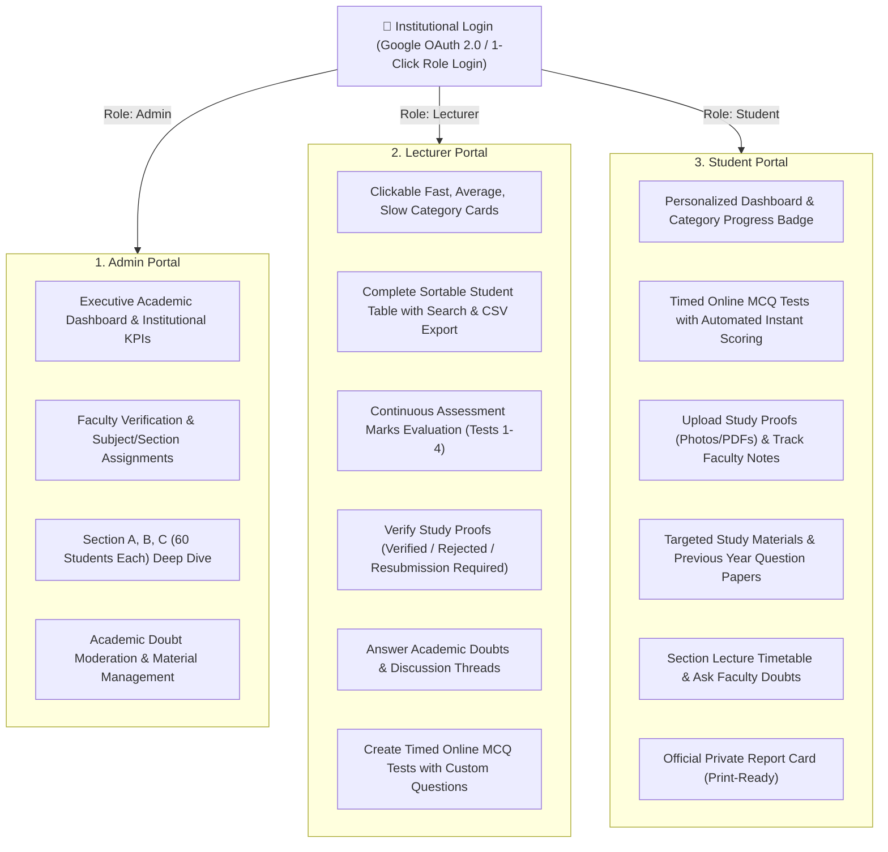

# Student Learning Performance Analysis System

[](https://fastapi.tiangolo.com/)
[](https://react.dev/)
[](https://tailwindcss.com/)
[](https://www.sqlite.org/)
[](LICENSE)

A complete, full-stack Academic Management & Student Learning Performance Analysis System featuring **Three Dedicated Portals (Admin, Lecturer, Student)**, **Google OAuth 2.0 & Role-Based Access Control (RBAC)**, **Timed Online MCQ Assessments**, **Study Proof Submissions & Verification**, **Academic Doubt Moderation**, and **Automated Learner Classification** for 180 students across Sections A, B, and C.

---

## 🏛️ System Architecture: Three Dedicated Portals



---

## 🌟 Key Upgrades & Features

### 1. 🔐 Google Login & Role-Based Authentication
* **Google OAuth 2.0 Integration**: Sign in with institutional accounts (`@studentmetrics.edu`).
* **1-Click Development/Demo Role Access**: Switch instantly between **Admin** (`Dr. S. K. Sharma`), **Lecturer** (`Prof. Alan Turing`), and **Student** (`Aarav Sharma - USN: 1MS21CS001`) without manual signup.
* **Role-Based Access Control (RBAC)**: Protected routes (`ProtectedRoute.jsx`) ensure students cannot access admin/faculty tools, and student report cards are strictly private.

---

### 2. 🛡️ Admin Portal (`/admin`)
* **Executive Oversight Dashboard**: Institutional analytics across all 180 students (class average, attendance percentage, pending faculty approvals, open doubts, submitted study proofs).
* **Faculty Verification & Assignments**: Review registered lecturers, approve/reject access, and assign subjects and sections.
* **Section Management**: Compare Section A (60 students), Section B (60 students), and Section C (60 students) with individual student metrics and cross-sectional averages.
* **Doubts Moderation & Academic Material Publishing**: Moderate inquiries and publish official curriculum materials.

---

### 3. 👨‍🏫 Lecturer Portal (`/lecturer`)
* **Clickable Learner Category Cards**:
  * 🟢 **Fast Learners Card**: Filters students with cumulative average $\ge 75\%$.
  * 🔵 **Average Learners Card**: Filters students with cumulative average between $50\%$ and $74\%$.
  * 🔴 **Slow Learners Card**: Filters students with cumulative average $< 50\%$.
* **Sortable Student Management Table**:
  * Opens upon clicking any card: includes **Rank, USN, Student Name, Section, Attendance %, Overall Average %, Trend, Strongest Subject, Focus Subject**, and a **"View Report"** button.
  * Search by Name or USN.
  * Filter by Section (A, B, C).
  * Sort by marks or attendance.
  * **Export filtered list as CSV**.
* **Marks Evaluation Grid**: Enter/update marks out of 100 for Test 1, Test 2, Test 3, and Test 4 across all 5 subjects with automated real-time recalculation of learner categories.
* **Study Proof Verification Desk**: Inspect student study logs and evidence, record review status (**Verified**, **Rejected**, or **Resubmission Required**), and provide constructive feedback notes.
* **Academic Doubt Resolution**: Answer student subject questions in organized discussion threads and mark issues as resolved.
* **Online MCQ Assessment Creator**: Create custom online tests with timers, questions, options, point values, and educational explanations.

---

### 4. 🎓 Student Portal (`/student`)
* **Personalized Dashboard**: View personal learner category, attendance tracking, test performance, and weak subject alerts.
* **Interactive Timed MCQ Tests**:
  * Live countdown timer with auto-submit on expiration.
  * Question navigator palette and clean radio selections.
  * Instant auto-grading with score percentage, pass/fail badge, and complete question breakdown with faculty explanations.
* **Upload Study Proofs**: Upload homework photos or PDFs, log study duration in minutes, and receive verified credit with lecturer feedback.
* **Recommended Study Materials**: Automated curriculum materials tailored to learner level (remedial guides for Slow Learners, standard notes for Average Learners, advanced exercises for Fast Learners).
* **Previous Year Question Papers**: Download past exam papers filterable by academic year and subject.
* **Weekly Section Timetable**: View lecture schedules, room numbers, and faculty assignments for your section.
* **Ask Faculty Doubts**: Submit academic questions and view faculty replies.
* **Official Private Report Card**: Print-ready formal academic transcript with department headers, complete marks breakdown, and personalized improvement suggestions.

---

## 📊 Core Academic Logic & Formulas

### 1. Learner Classification Rules
$$\text{Fast Learner} \iff \text{Overall Average} \ge 75\%$$
$$\text{Average Learner} \iff 50\% \le \text{Overall Average} < 75\%$$
$$\text{Slow Learner} \iff \text{Overall Average} < 50\%$$

### 2. Learning Trend Detection
$$\Delta = \left(\frac{\text{Test 3} + \text{Test 4}}{2}\right) - \left(\frac{\text{Test 1} + \text{Test 2}}{2}\right)$$
* **Improving**: $\Delta > +2.0\%$
* **Declining**: $\Delta < -2.0\%$
* **Consistent**: $-2.0\% \le \Delta \le +2.0\%$

---

## 🛠️ Technology Stack

| Layer | Technologies |
| :--- | :--- |
| **Frontend** | React 18, Vite, Tailwind CSS, Recharts, React Router DOM v6, Axios, Lucide React Icons |
| **Backend** | Python 3.13, FastAPI, SQLAlchemy 2.0 (ORM), Pandas, NumPy, Pydantic v2 |
| **Database** | SQLite 3 (`students.db`) with relational integrity & foreign keys |
| **Authentication** | Google OAuth 2.0 & HMAC-SHA256 JWT Role-Based Access Control |

---

## 🚀 Quick Start Guide

### Prerequisites
* Python 3.9+ installed.
* Node.js (v18+) and npm installed.

---

### Option A: 1-Click Launchers (Windows)
Double-click any launcher in the project root:
* **`run_all.bat`**: Starts both Backend & Frontend servers and automatically launches the app in your browser!
* **`run_backend.bat`**: Starts the FastAPI backend server on `http://127.0.0.1:8000`.
* **`run_frontend.bat`**: Starts the React Vite frontend server on `http://localhost:5173`.

---

### Option B: Manual Command Line

#### 1. Start the Backend Server
```powershell
cd "student-metrics\backend"
python -m uvicorn main:app --reload --host 127.0.0.1 --port 8000
```
* **API Home**: [http://127.0.0.1:8000](http://127.0.0.1:8000)
* **Swagger API Docs**: [http://127.0.0.1:8000/docs](http://127.0.0.1:8000/docs)

#### 2. Start the Frontend Server
In a new terminal window:
```powershell
cd "student-metrics\frontend"
npm.cmd run dev
```
*(Note: Use `npm.cmd run dev` on Windows PowerShell to prevent `npm.ps1` script execution policy errors).*

* **Application URL**: [http://localhost:5173](http://localhost:5173)

---

## 📁 Project Structure

```text
student-mini-project/
├── run_all.bat                      # 1-Click start both servers + open browser
├── run_backend.bat                  # 1-Click start backend
├── run_frontend.bat                 # 1-Click start frontend
├── push_to_student_mini_project.bat # 1-Click sync to GitHub
├── .gitignore                       # Excludes env, uploads, and non-code docs
├── README.md                        # Master project documentation
└── student-metrics/
    ├── backend/
    │   ├── main.py                  # FastAPI app & routes initialization
    │   ├── models.py                # SQLAlchemy DB models (Students, Users, Tests, Doubts, Proofs)
    │   ├── schemas.py               # Pydantic v2 validation models
    │   ├── auth.py                  # JWT tokens & role verification
    │   ├── analysis.py              # Learner classification & trend calculation algorithms
    │   ├── seed_portals.py          # Safe database initial seeding
    │   ├── database.py              # SQLite engine & session setup
    │   └── routers/
    │       ├── auth_routes.py       # Login & OAuth endpoints
    │       ├── admin_routes.py      # Admin portal endpoints
    │       ├── lecturer_routes.py   # Lecturer portal endpoints
    │       └── student_routes.py    # Student portal endpoints
    └── frontend/
        ├── index.html
        ├── vite.config.js
        └── src/
            ├── App.jsx              # Main router with ProtectedRoute guards
            ├── context/
            │   └── AuthContext.jsx  # Authentication context & demo roles
            ├── components/
            │   ├── AdminLayout.jsx   # Admin sidebar & header layout
            │   ├── LecturerLayout.jsx# Lecturer sidebar & header layout
            │   ├── StudentLayout.jsx # Student sidebar & header layout
            │   └── ProtectedRoute.jsx# Role-Based Access Control gatekeeper
            ├── pages/
            │   ├── LoginPage.jsx    # Google Sign-In & 1-Click Role selector
            │   ├── admin/           # Admin Dashboard, Lecturers, Sections, Doubts, Materials
            │   ├── lecturer/        # Lecturer Dashboard, Clickable Classification, Marks, Proofs, Tests
            │   └── student/         # Student Dashboard, Online MCQ Tests, Proofs, Timetable, Doubts, Report Card
            └── services/
                └── api.js           # Axios API service client
```

---

## 📄 License
This project is open-source and developed as a college academic mini-project under the MIT License.
